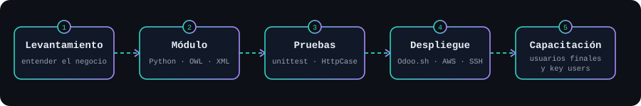

<div align="center">



</div>

Hola, soy Carlos. Convierto la forma en que trabaja un negocio en un sistema que funciona sobre **Odoo**: levanto el proceso, escribo el módulo, lo pruebo, lo despliego y capacito a quien lo va a usar. Vivo en Toluca y trabajo con clientes de México, Estados Unidos, Japón y Australia.

<div align="center">



</div>

## Lo que sé hacer

- **Gestionar proyectos de ERP** de principio a fin: levantamiento, estimación, propuesta, entrega y capacitación.
- **Desarrollar a la medida** módulos, integraciones y reportes, con pruebas y despliegue en producción.
- **Cuidar los datos:** optimizar, depurar y auditar bases de datos grandes antes de migrar.
- **Integrar sistemas** con APIs, webhooks y mensajería, entre ellos WhatsApp.
- **Automatizar con IA:** agentes que apoyan el diagnóstico, las pruebas y la documentación.
- **Operar el negocio en planta, ruta y bodega:** manufactura, punto de venta, inventario, rentas y facturación electrónica.

## Con qué trabajo

```text
Odoo        17 · 18 · 19  ·  ORM, módulos, OWL, QWeb, crons, CFDI 4.0
Python      unittest y HttpCase  ·  pandas  ·  openpyxl
Datos       PostgreSQL (consultas, índices, tamaño y TOAST)  ·  Power BI y DAX
Integra     REST · GraphQL · SOAP · XML-RPC · webhooks · WhatsApp Business
Despliegue  Odoo.sh · AWS · Docker · Linux por SSH · Git
IA          agentes y LLMs para diagnóstico y pruebas  ·  visión por computadora
```

## Cómo trabajo

- Código sin ruido: nombres que se explican solos, sin comentarios que repitan lo que ya dice el código.
- Cada módulo con sus pruebas corriendo en una base limpia antes de entregarse.
- Cifras reales: mido antes y después de cada corrección.

<div align="center">

<sub>Toluca, México · Odoo · Python · PostgreSQL</sub>

</div>
